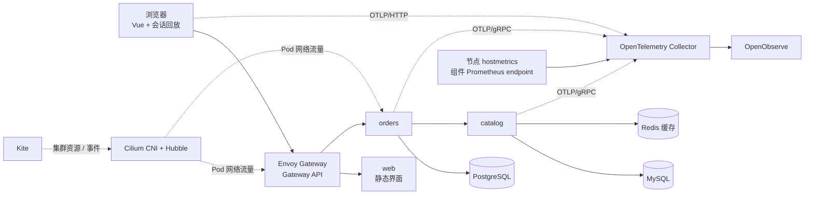

# 云原生平台演示架构

云上生产版的节点、存储、OpenObserve 和安装边界见
[`production-blueprint.md`](production-blueprint.md)。本文件描述的是可复现的本地
k3d 演示，不能直接用它的单副本 PVC 和 port-forward 配置替代生产部署。

Cloud Native Platform Demo 是一个刻意保持小而完整、同时按生产形态组织的
平台参考项目。它把服务边界、流量策略、遥测管道、数据存储和运维流程放在同一个
本地 k3d 集群中，方便复现和验证。

## 分层模型

| 层级 | 职责 | 仓库位置 |
| --- | --- | --- |
| 边缘入口 | Envoy Gateway、Gateway API 契约和路径路由 | `infra/network` |
| 运行时 | k3s、Cilium CNI、eBPF 服务数据面、网络策略和 Hubble 流量可见性 | `infra/k3s`、`infra/network` |
| 业务工作负载（本地示例） | GoFr `orders`、`catalog` API 以及 Vue Web 客户端 | `services`、`frontend/web`、`infra/apps` |
| 数据层（本地示例） | PostgreSQL、MySQL 和 Redis 支撑服务 | `infra/data` |
| 可观测性（本地示例） | OTel Operator、OpenObserve 和 Prometheus receiver | `infra/observability/collector-operator.yaml`、`infra/observability/dashboards/` |
| 生产平台 | K3s、Cilium CNI、Envoy Gateway、Gateway API、KEDA、cert-manager、Kured、SUC、OTel 和 OpenObserve | `infra/production`、`scripts/production` |
| 可观测性（生产） | OTel Operator、Cilium/Hubble 和 OpenObserve | `infra/production/observability` |
| 运维层 | Kite 控制台、可重复的生命周期操作和验收检查 | `infra/dashboard`、`scripts`、`Makefile` |

边界是刻意设计的：应用代码不包含 Kubernetes 对象，基础设施不包含应用构建逻辑，
只有脚本负责组装本地运行环境。

## 请求与信号路径

`orders` 调用 `catalog` 时会传播 W3C trace context，因此一笔订单请求可以作为端到端
链路追踪示例，而不是一组彼此割裂的健康检查。GoFr 还会生成结构化请求日志和
Prometheus 指标；应用处理器额外记录业务 span 以及缓存命中/未命中事件，因此同一请求
可以从三类信号进行排查。

## 生产形态设计

- Gateway API 是公开契约；Envoy Gateway 管理 Envoy 数据面 Service。云上通过
  LoadBalancer Service 暴露，本地 k3d 使用 NodePort 并由 port-forward 映射到回环端口。
- 工作负载配置多副本、资源请求/限制、就绪和存活探针、PodDisruptionBudget 以及基于
  CPU 的 HPA。
- 无状态工作负载使用滚动更新和按主机名拓扑分布；探针区分启动、就绪和存活，避免
  依赖较慢的进程尚未准备好就接收流量。
- 项目不部署独立 Prometheus Server。Prometheus 格式指标由 OTel Collector 采集并写入
  OpenObserve；HPA 只依赖 K3s 内置 metrics-server，KEDA 查询 OpenObserve 的 PromQL API。
- 应用密钥通过 Kubernetes Secret 注入。仓库中的值只用于本地教学环境。
- Cilium 替换 k3s 默认网络组件；本地 k3d 创建时关闭 kube-proxy，并在 Cilium 中启用
  kube-proxy replacement 为 Envoy Gateway 的 Service 提供 eBPF 服务数据面。Cilium 不再
  管理 Gateway API 或 Envoy 代理。
- 本地演示的浏览器遥测通过 Gateway 进入 Collector，Collector 负责入口密钥校验、CORS、
  限流、脱敏和批处理；生产版浏览器 RUM 使用 OpenObserve 的独立 client token，后端
  OTLP 仍只由 Collector 使用独立凭据导出。
- 本地可观测性栈完全自包含。生产版使用
  `docs/production-blueprint.md` 中的 OpenObserve 分布式部署、S3 和 PostgreSQL。
- 业务事件名称和属性由 [`observability-events.md`](observability-events.md) 统一定义，
  前端通过项目 Telemetry API 发送，厂商 SDK 只位于适配层。

## 本地化取舍

集群使用 1 个 server、2 个 agent，状态存储使用单副本，PVC 使用 local-path，应用镜像
使用导入 k3d 的 `:dev` 标签。这些取舍让演示可以在工作站上稳定复现；生产部署应为每个
镜像固定 release 或 digest，使用托管数据服务或经过验证的存储类，将密钥外置，并定义
备份/恢复和 SLO 策略。
